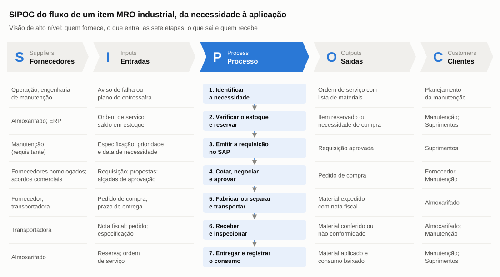
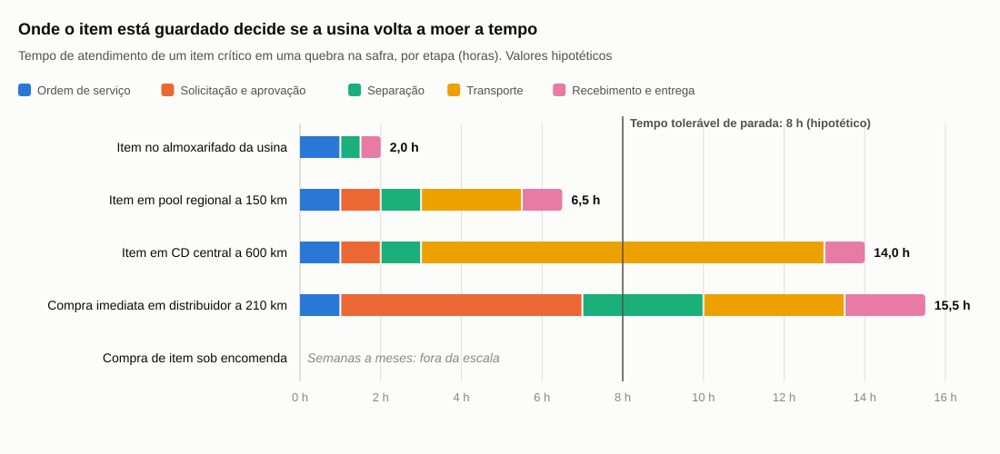

# Fluxo de materiais e SIPOC

:::info Resumo executivo
1. **O fluxo de um item MRO tem sete etapas e dois caminhos:** o planejado, da entressafra, que usa a compra competitiva, e o de quebra, na safra, que depende do estoque local ou das compras imediata e emergencial.
2. **Na quebra, o tempo de atendimento varia de cerca de 2 horas a mais de 15 horas** no cenário hipotético. A diferença vem da localização do estoque e do fluxo de aprovação, não só da distância.
3. **Centralizar acrescenta uma etapa ao fluxo,** a transferência do CD até a usina. É esse tempo que a regra da página de Modelos compara com o tempo tolerável de parada.
:::

Esta página mapeia como um material MRO percorre o caminho da necessidade até a aplicação no equipamento. Ela usa três ferramentas:

- O **SIPOC**, que dá a visão de alto nível do processo: fornecedores, entradas, processo, saídas e clientes ([AHRQ](https://digital.ahrq.gov/health-it-tools-and-resources/evaluation-resources/workflow-assessment-health-it-toolkit/all-workflow-tools/sipoc), s.d.).
- O **fluxograma por raias**, que mostra quem executa cada etapa e onde o fluxo se divide.
- O **mapa de lead time**, uma versão simplificada do mapeamento do fluxo de valor de Rother e Shook (1999), que mostra onde o tempo se acumula.

As regras de compra vêm da Política de Suprimentos da Raízen ([PLT.02](https://www.raizen.com.br/items-files/item-1495-plt-02-politica-sustentavel-de-suprimentos.pdf), 2025c). As áreas e responsabilidades seguem o mapa de interações e a matriz RACI da página [Empresa, manutenção e Suprimentos](../002_Contexto_Setorial_Operacao_Suprimentos/Empresa_Operacao_Suprimentos.md).

---

## Escopo do processo

- **Evento inicial:** a necessidade de material é identificada, seja pelo plano de manutenção de entressafra, seja pela detecção de uma falha durante a safra.
- **Evento final:** o material é entregue a quem executa a manutenção e o consumo é registrado na ordem de serviço.
- **Unidade de análise:** um item MRO **industrial** de uma usina, como sobressalentes de moenda, caldeira ou bombas e consumíveis de manutenção. A frota agrícola fica fora do escopo.
- **Premissas do cenário:**
  - Usina genérica com almoxarifado próprio. O modelo descentralizado é a base porque a organização física dos estoques da Raízen não é pública (ver [Modelos de gestão e armazenagem](./Modelos_Gestao_Armazenagem.md)).
  - As modalidades de compra e as alçadas seguem a PLT.02, que é pública.
  - Os nomes das áreas são genéricos. Na empresa, as funções podem ter outros nomes ou estar agrupadas de outra forma.
  - Os tempos usados no mapa de lead time são hipotéticos e estão declarados na seção [Mapa de lead time](#mapa-de-lead-time).

---

## SIPOC

Figura 1 — SIPOC do fluxo de um item MRO industrial

Fonte: Elaborado pelos autores com base em Raízen (2025c; 2026d) e AHRQ (s.d.). O detalhamento de cada linha está na Tabela 1.

Tabela 1 — SIPOC do fluxo de um item MRO industrial, da necessidade à aplicação

| Suppliers — Fornecedores | Inputs — Entradas | Process — Processo | Outputs — Saídas | Customers — Clientes |
|---|---|---|---|---|
| Operação; engenharia de manutenção | Aviso de falha ou plano de entressafra; histórico de consumo | 1. Identificar a necessidade | Ordem de serviço com lista de materiais | Planejamento da manutenção |
| Almoxarifado; ERP | Ordem de serviço; saldo em estoque | 2. Verificar o estoque e reservar o item | Item reservado ou necessidade de compra | Manutenção; Suprimentos |
| Manutenção (requisitante) | Especificação técnica; prioridade; "data de remessa coerente com a necessidade" | 3. Emitir a requisição de compra no SAP | Requisição aprovada pelo requisitante | Suprimentos |
| Fornecedores homologados; acordos comerciais | Requisição; número mínimo de propostas; alçadas do Manual de Autoridades | 4. Cotar, negociar e aprovar | Pedido de compra, emitido automaticamente quando há acordo comercial | Fornecedor; Manutenção |
| Fornecedor; transportadora | Pedido de compra; prazo de entrega | 5. Fabricar ou separar e transportar | Material expedido com nota fiscal | Almoxarifado |
| Transportadora | Nota fiscal; pedido; especificação técnica | 6. Receber e inspecionar | Material conferido e armazenado, ou não conformidade registrada | Almoxarifado; Manutenção |
| Almoxarifado | Reserva; ordem de serviço | 7. Entregar e registrar o consumo | Material aplicado; baixa no sistema; histórico de consumo atualizado | Manutenção (execução); Suprimentos (reposição) |

Fonte: Elaborado pelos autores com base em Raízen (2025c; 2026d) e AHRQ (s.d.).

As etapas 3 e 4 seguem regras documentadas na PLT.02: requisição no SAP com prioridade e data de necessidade, cotação com fornecedores homologados, aprovação por alçadas e pedido automático quando há acordo comercial. A etapa 5 é parcialmente documentada: o Portal Único de Compras prevê o "acompanhamento de entregas" ([Raízen](https://www.raizen.com.br/en/about-raizen/suppliers-portal), 2026d). As etapas 1, 2, 6 e 7 são *inferência dos autores* com base na prática do setor, já que não há descrição pública desse trecho do fluxo na Raízen.

---

## Detalhamento do fluxo

A Figura 2 mostra as sete etapas distribuídas pelas áreas responsáveis e os dois pontos em que o fluxo se divide: a verificação do estoque e a avaliação do risco de parada.

Figura 2 — Fluxograma por raias: caminho planejado e caminho de quebra

Fonte: Elaborado pelos autores com base em Raízen (2025c). Áreas genéricas; responsabilidades conforme a matriz RACI (hipótese) do Entregável 1.

### Caminho planejado: manutenção de entressafra

A necessidade nasce do plano de manutenção e percorre as sete etapas pela **modalidade competitiva**: cotação com o número mínimo de propostas e aprovação pelas alçadas ([Raízen](https://www.raizen.com.br/items-files/item-1495-plt-02-politica-sustentavel-de-suprimentos.pdf), 2025c). É o caminho mais barato, mas também o mais longo. Para itens fabricados sob encomenda, a requisição precisa ser emitida meses antes da parada. Isso é coerente com a concentração de 88% do investimento em manutenção de entressafra entre outubro e março ([Raízen](https://d169uzu5o4xu1k.cloudfront.net/e24e1732-fe1c-4eaf-9a28-ed09ccc472b1/2026/810dc9a4-f5df-4e56-99a7-737e2a01a829.pdf), 2026a).

### Caminho de quebra: falha durante a safra

O fluxo se divide na etapa 2:

- **O item está no almoxarifado:** o fluxo vai direto para a etapa 7. É o atendimento mais rápido.
- **O item não está em estoque:** a PLT.02 prevê duas saídas para situações de "risco iminente [...] de parada de equipamentos e/ou produção" ([Raízen](https://www.raizen.com.br/items-files/item-1495-plt-02-politica-sustentavel-de-suprimentos.pdf), 2025c):
  - **Compra imediata:** Suprimentos prioriza o prazo de entrega e pode aceitar uma única proposta.
  - **Compra emergencial:** o próprio usuário compra e regulariza o processo depois, fora da negociação de Suprimentos.

*Inferência dos autores:* quanto mais necessidades são descobertas na quebra, e não no plano, mais o fluxo depende das compras imediata e emergencial, que são mais caras e menos controladas.

### SIPOC comparativo: o que muda no modelo centralizado

Tabela 2 — Diferenças do SIPOC entre os modelos descentralizado e centralizado

| Elemento | Descentralizado (base desta página) | Centralizado | Efeito da centralização |
|---|---|---|---|
| Fornecedores (S) | Entregam em cada usina | Entregam no CD | Compras e fretes consolidados em menos pontos de entrega |
| Entradas (I) | Pedido de compra por usina | Pedido de compra do CD e pedido de transferência da usina | Nova entrada de informação entre a usina e o CD |
| Processo (P) | Sete etapas | Etapa nova entre a 2 e a 7: **transferir do CD para a usina** | Tempo de atendimento maior para itens que não ficam na usina |
| Saídas (O) | Material no almoxarifado da usina | Material no CD; nota de transferência para a usina | Uma etapa adicional de recebimento |
| Clientes (C) | Manutenção da usina | O CD passa a ser cliente do fornecedor e fornecedor da usina | Mais um elo de coordenação entre áreas |

Fonte: Elaborado pelos autores.

No modelo híbrido, o fluxo de cada item segue a coluna correspondente à sua posição de estoque, definida pela regra de segmentação da página [Modelos de gestão e armazenagem](./Modelos_Gestao_Armazenagem.md).

### Mapa de lead time {#mapa-de-lead-time}

Para mostrar onde o tempo se acumula, a Tabela 3 decompõe o tempo de atendimento de uma quebra na safra em quatro cenários de localização do item. Os tempos são **hipotéticos** e servem para comparar os cenários, não para medir a operação real.

Tabela 3 — Tempo de atendimento de um item crítico em uma quebra na safra, por cenário (horas, hipotético)

| Cenário | Ordem de serviço | Solicitação e aprovação | Separação | Transporte | Recebimento e entrega | **Total** | Dentro do limite de 8 h? |
|---|---:|---:|---:|---:|---:|---:|---|
| Item no almoxarifado da usina | 1,0 | 0,0 | 0,5 | 0,0 | 0,5 | **2,0** | Sim |
| Item em *pool* regional a 150 km | 1,0 | 1,0 | 1,0 | 2,5 | 1,0 | **6,5** | Sim |
| Item em CD central a 600 km | 1,0 | 1,0 | 1,0 | 10,0 | 1,0 | **14,0** | Não |
| Compra imediata em distribuidor a 210 km | 1,0 | 6,0 | 3,0 | 3,5 | 2,0 | **15,5** | Não |
| Compra de item sob encomenda | — | — | — | — | — | Semanas a meses | Não |

Fonte: Elaborado pelos autores. Premissas: velocidade média do transporte rodoviário de 60 km/h, incluindo paradas; tempo tolerável de parada de 8 horas; demais tempos estimados pelos autores, sem base em dados da Raízen.

Figura 3 — Tempo de atendimento de um item crítico em uma quebra na safra, por cenário e etapa

Fonte: Elaborado pelos autores. Valores hipotéticos, os mesmos da Tabela 3.

**Leitura da Tabela 3 e da Figura 3** (*inferência dos autores*):

1. **Distância.** Com o limite hipotético de 8 horas, só o estoque na usina e o *pool* regional atendem a uma quebra de ativo crítico. É a regra da página de Modelos aplicada a números: um CD distante não protege itens críticos de reposição imediata.
2. **Aprovação.** Na compra imediata, a maior parcela do tempo é administrativa (solicitação e aprovação), e não o transporte. Por isso a PLT.02 admite uma única proposta nesse caso, e a compra emergencial existe como último recurso.
3. **Planejamento.** No caminho planejado, a lógica se inverte. Considere um item sob encomenda para uma parada em janeiro, com cerca de 5 dias para requisição e especificação, 15 dias para cotação e alçadas, 60 dias de fabricação e 5 dias de transporte e recebimento (valores hipotéticos). O ciclo soma cerca de 85 dias, e a requisição precisa ser emitida até o início de outubro. O risco desse caminho não é a demora de horas, e sim a necessidade que entra tarde no plano.

---

## Pontos de controle e riscos

Tabela 4 — Pontos de controle e riscos por etapa do fluxo

| Etapa | Responsável | Informação necessária | Risco | Controle ou indicador |
|---|---|---|---|---|
| 1. Identificar a necessidade | Manutenção | Plano de entressafra; histórico de falhas | A necessidade só aparece na quebra | Percentual de ordens corretivas sobre o total de ordens de serviço |
| 2. Verificar o estoque e reservar | Almoxarifado | Saldo confiável; cadastro sem duplicidades | Saldo errado ou item cadastrado com outro código | Acurácia de inventário; revisão de cadastro (ver [Mercado fornecedor e logística](./Mercado_Fornecedor_Logistica.md)) |
| 3. Emitir a requisição | Manutenção | Especificação; prioridade; data de necessidade | Prioridade inflada ou data incoerente com a necessidade | Percentual de requisições urgentes. A PLT.02 exige justificar os casos urgentes |
| 4. Cotar, negociar e aprovar | Suprimentos | Fornecedores homologados; alçadas; acordos comerciais | Fornecedor único e lead time longo | Tempo entre requisição e pedido; uso da "opção técnica" e de fornecedores "estratégicos ou exclusivos" (PLT.02) |
| 5. Fabricar ou separar e transportar | Fornecedor; transportadora | Pedido; prazo; condições de pagamento | Atraso ou despriorização do pedido, agravados pelo fim do risco sacado | Pontualidade de entrega, que já faz parte do "Index do fornecedor" (PLT.02) |
| 6. Receber e inspecionar | Almoxarifado | Nota fiscal; pedido; especificação | Material divergente do pedido | Registro de não conformidades na ferramenta RNC (PLT.02) |
| 7. Entregar e registrar o consumo | Almoxarifado; Manutenção | Reserva; ordem de serviço | Consumo não registrado, o que distorce a reposição | Nível de serviço do almoxarifado; percentual de compras emergenciais |

Fonte: Elaborado pelos autores com base em Raízen (2025c). Responsáveis conforme a matriz RACI (hipótese) do Entregável 1.

---

## Aprendizados

Os aprendizados abaixo são pontos para investigar, não propostas para o case real (*inferência dos autores*):

- **Gargalo de tempo na quebra.** O fluxo competitivo de cotação e alçadas não é compatível com uma parada na safra. A compra emergencial funciona como válvula de escape, mas fica fora do controle de Suprimentos. Vale investigar quanto do volume de compras passa por esse atalho.
- **Dependência do cadastro.** As etapas 2 e 7 dependem de saldo e cadastro confiáveis. Um erro nessas etapas transforma um item disponível em uma compra urgente.
- **Dependência de fornecedores exclusivos.** Nas etapas 4 e 5, peças com fornecedor único e longo prazo de fabricação concentram o risco. O fim do risco sacado pode ter tornado esses fornecedores menos dispostos a priorizar pedidos.
- **A localização do estoque decide o tempo de atendimento.** A Tabela 3 mostra que o mesmo item pode levar 2 ou 14 horas para chegar, conforme o local onde está guardado. Esse tempo deve entrar como critério na [matriz de decisão](./Matriz_Decisao_Multicriterio.md).

:::note Limitações
* As etapas 1, 2, 6 e 7 e os responsáveis por etapa são inferências. A Raízen não publica o fluxo interno de materiais.
* Os tempos da Tabela 3 e do exemplo do caminho planejado são hipotéticos. O limite de 8 horas é uma premissa dos autores, e não um parâmetro da empresa.
* A análise cobre apenas materiais MRO industriais. A frota agrícola tem fluxo e fornecedores próprios e ficou fora do escopo.
:::

---

## Fontes

- AHRQ — AGENCY FOR HEALTHCARE RESEARCH AND QUALITY. Supplier, Inputs, Process, Outputs, Customer (SIPOC). Workflow Assessment for Health IT Toolkit. s.d. Disponível em: https://digital.ahrq.gov/health-it-tools-and-resources/evaluation-resources/workflow-assessment-health-it-toolkit/all-workflow-tools/sipoc. Acesso em: 29/10/2026.
- RAÍZEN. PLT.02 — Política de Suprimentos (versão 15). 2025c. Disponível em: https://www.raizen.com.br/items-files/item-1495-plt-02-politica-sustentavel-de-suprimentos.pdf. Acesso em: 06/10/2026.
- RAÍZEN. Relatório de Resultados: 4º Trimestre e Ano-Safra 2025'26. 2026a. Disponível em: https://d169uzu5o4xu1k.cloudfront.net/e24e1732-fe1c-4eaf-9a28-ed09ccc472b1/2026/810dc9a4-f5df-4e56-99a7-737e2a01a829.pdf. Acesso em: 06/10/2026.
- RAÍZEN. Suppliers Portal (Portal de Fornecedores). 2026d. Disponível em: https://www.raizen.com.br/en/about-raizen/suppliers-portal. Acesso em: 06/10/2026.
- ROTHER, Mike; SHOOK, John. *Learning to See: value stream mapping to add value and eliminate muda*. Cambridge, MA: Lean Enterprise Institute, 1999. Disponível em: https://www.lean.org/store/book/learning-to-see/. Acesso em: 29/10/2026.
