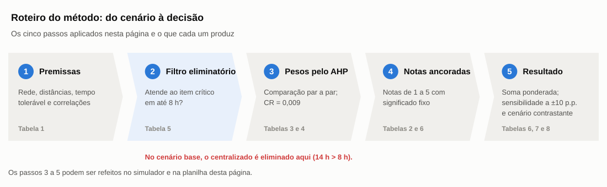
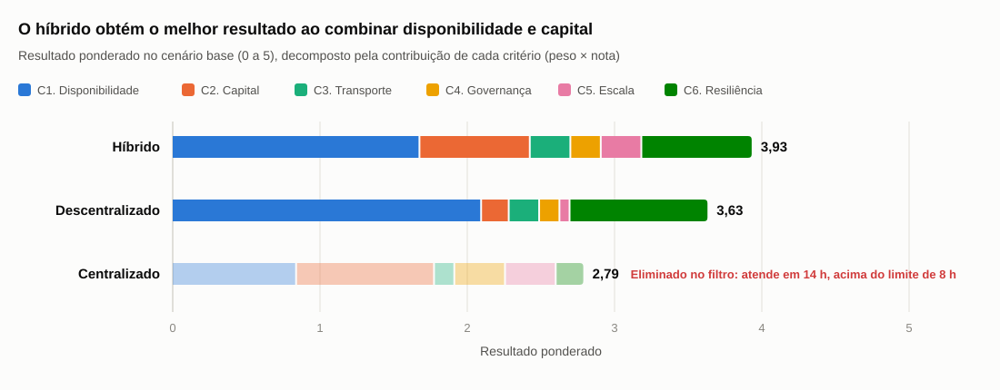
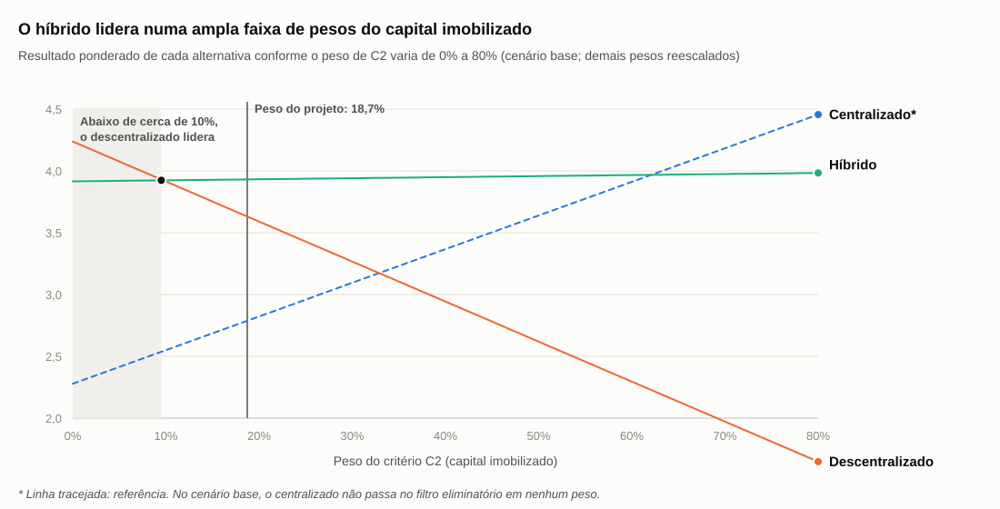

import MatrizDecisao from '@site/src/components/MatrizDecisao';

# Critérios e matriz de decisão

:::warning Aplicação genérica
A matriz deve ser aplicada a um cenário hipotético ou à empresa pesquisada com dados públicos. Não utilizar informações da Atvos nem apresentar uma recomendação para o case real.
:::

:::info Resumo executivo
1. **No cenário hipotético, o modelo híbrido obteve o melhor resultado (3,93 de 5),** seguido do descentralizado (3,63). O centralizado foi eliminado antes da soma, porque não atende a um item crítico dentro do tempo tolerável de parada.
2. **O resultado depende do contexto.** Numa rede concentrada, com o CD a 100 km, o centralizado passa no filtro e empata tecnicamente com o híbrido (3,95 contra 3,93).
3. **O resultado é apoio à análise, não resposta automática.** Os pesos e as notas são julgamentos dos autores, e o simulador abaixo permite testar outros valores.
:::

Esta página fecha a sequência de análise do Entregável 2. Os critérios vêm das sete dimensões da página [Modelos de gestão e armazenagem](./Modelos_Gestao_Armazenagem.md) e dos fatores logísticos da página [Mercado fornecedor e logística](./Mercado_Fornecedor_Logistica.md). Os tempos de atendimento vêm do mapa de lead time da página [Fluxo de materiais e SIPOC](./Fluxo_Materiais_SIPOC.md).

O método tem cinco passos:

1. Declarar as premissas do cenário antes de dar qualquer nota.
2. Aplicar um **filtro eliminatório**: a alternativa precisa atender a um item crítico dentro do tempo tolerável de parada.
3. Definir os pesos dos critérios pelo **AHP** (*Analytic Hierarchy Process*), a comparação par a par de Saaty ([Saaty](https://doi.org/10.1016/0377-2217(90)90057-I), 1990).
4. Atribuir notas com uma **escala ancorada**, em que cada nota tem um significado definido por critério.
5. Calcular o resultado ponderado e testar a **sensibilidade** aos pesos e a um cenário contrastante.

Figura 1 — Roteiro do método multicritério

Fonte: Elaborado pelos autores com base em Saaty (1990).

---

## Cenário analisado

O cenário é hipotético. Ele usa como referência o porte da rede da Raízen e as mesmas premissas de tempo e distância da página de SIPOC.

Tabela 1 — Premissas do cenário genérico

| Premissa | Valor | Origem |
|---|---:|---|
| Número de usinas da rede | 24 | [Números-base](./Retomada_Contexto.md#numeros-base) do projeto (Raízen, 31/03/2026) |
| Grupos regionais | 4 | Premissa dos autores |
| Distância da usina ao *pool* regional | 150 km | Premissa (SIPOC, Tabela 3) |
| Distância da usina ao CD central | 600 km | Premissa (SIPOC, Tabela 3) |
| Tempo tolerável de parada de um ativo crítico | 8 h | Premissa (SIPOC) |
| Velocidade média do transporte rodoviário | 60 km/h | Premissa (SIPOC), incluindo paradas |
| Tempo fora do transporte (ordem, solicitação, separação, recebimento) | 4 h | Premissa (SIPOC, Tabela 3) |
| Correlação das demandas | 0,1 (falha aleatória) e 0,7 (desgaste) | Premissa (Modelos, Tabela 4) |

Fonte: Elaborado pelos autores.

As três alternativas seguem o espectro da página de Modelos:

- **Centralizado:** um CD único abastece as 24 usinas.
- **Descentralizado:** cada usina mantém um almoxarifado completo.
- **Híbrido:** os itens críticos de reposição imediata ficam na usina, e os sobressalentes caros de giro muito baixo ficam num *pool* em cada grupo regional.

---

## Escala de avaliação

- **Nota mínima (1):** a alternativa tem o pior desempenho possível no critério, conforme a âncora da Tabela 2.
- **Nota máxima (5):** a alternativa tem o melhor desempenho possível no critério, conforme a âncora da Tabela 2.
- **Regra para notas intermediárias:** só se usam notas inteiras, e cada nota corresponde a uma descrição fixa por critério. Isso evita notas arbitrárias e permite que outra pessoa chegue à mesma avaliação.

Tabela 2 — Escala ancorada de avaliação por critério

| Critério | 5 | 4 | 3 | 2 | 1 |
|---|---|---|---|---|---|
| C1. Disponibilidade para itens críticos | Atendimento em até 2 h | Todos os itens críticos dentro do limite (8 h) | Até 12 h | Até 2 vezes o limite (16 h) | Mais de 2 vezes o limite |
| C2. Capital imobilizado | Redução do estoque de segurança de 60% ou mais | 40% a 60% | 20% a 40% | 5% a 20% | Menos de 5% (sem compartilhamento) |
| C3. Custo de transporte | Abastecimento consolidado, sem transferências longas | Consolidado, com transferências curtas (até 150 km) para parte dos itens | Entregas fracionadas em cada unidade, sem transferências | Consolidado, mas com transferências longas para todos os itens | Fracionado e com transferências longas |
| C4. Governança | Um único ponto de estoque e cadastro | Poucos pontos (até 5) com cadastro único | Vários pontos com cadastro único e regras de segmentação | Um ponto por unidade, com cadastro corporativo compartilhado | Um ponto por unidade, com cadastros independentes |
| C5. Escala de armazenagem | Um único ponto concentra armazenagem e recebimento | Poucos pontos concentram os itens de maior valor | Parte relevante do volume concentrada | Pequena parte do volume concentrada | Cada unidade armazena e recebe tudo |
| C6. Resiliência | Uma interrupção afeta apenas uma unidade | Afeta um grupo regional, com itens críticos protegidos na usina | Afeta um grupo regional inteiro | Afeta toda a rede, com rota curta e alternativas | Afeta toda a rede e depende de rota longa |

Fonte: Elaborado pelos autores.

---

## Critérios e pesos

Os seis critérios agrupam as sete dimensões da página de Modelos. Nível de serviço, tempo de atendimento e risco de parada foram reunidos em C1 porque medem quase o mesmo fator, e contá-los separadamente daria peso dobrado à disponibilidade. A tributação ficou fora dos critérios; o motivo está em [Sensibilidade e limitações](#sensibilidade-e-limitações).

Tabela 3 — Critérios, evidências e pesos

| Critério | Definição | Evidência usada | Peso | Justificativa do peso |
|---|---|---|---:|---|
| C1. Disponibilidade para itens críticos | Tempo de atendimento a um item crítico, comparado ao tempo tolerável de parada | Mapa de lead time (SIPOC, Tabela 3); regra de decisão de Modelos; operação 24/7 sem estoque de cana (Entregável 1) | 41,9% | Mais importante que todos os demais: uma parada na safra interrompe a moagem, e a cana colhida perde valor |
| C2. Capital imobilizado | Estoque de segurança total da rede | Efeito de compensação de demandas (Modelos, Tabela 4); queda de 24% do almoxarifado desde 2024 (Entregável 1) | 18,7% | Pressão sobre o capital de giro durante a recuperação extrajudicial. Mesma importância que resiliência |
| C3. Custo de transporte | Frete de abastecimento e de transferências | Fator frete (Mercado, Tabela 2); componentes do custo total (Modelos, Tabela 5) | 6,9% | O custo de parada supera o custo de frete |
| C4. Governança | Número de pontos de estoque e qualidade do cadastro | Padronização e cadastro (Mercado); caso CSN | 6,9% | Importante para a eficiência, mas não compensa uma usina parada |
| C5. Escala de armazenagem | Concentração da armazenagem e do recebimento | Comparação dos modelos (Modelos, Tabela 1); Central de Compras (PLT.02) | 6,9% | A negociação de compras já é centralizada em todos os modelos (PLT.02), por isso o ganho de escala restante é pequeno |
| C6. Resiliência | Efeito de uma interrupção num ponto de estoque ou numa rota | Distância, chuvas e bloqueios (Mercado, Tabela 2); dispersão em quatro estados | 18,7% | Protege a continuidade quando falha o CD ou a rota. Mesma importância que capital |
| **Total** |  |  | **100%** |  |

Fonte: Elaborado pelos autores. Pesos calculados pelo AHP (Tabela 4).

### Como os pesos foram obtidos: AHP

Cada par de critérios foi comparado na escala de Saaty: 1 indica igual importância, 3 importância moderada, 5 forte, 7 muito forte e 9 extrema ([Saaty](https://doi.org/10.1016/0377-2217(90)90057-I), 1990). Os pesos são a média geométrica de cada linha da matriz de comparações, normalizada para somar 100%.

Tabela 4 — Julgamentos par a par do AHP (critério da linha em relação ao da coluna)

| Critério | C1 | C2 | C3 | C4 | C5 | C6 |
|---|---:|---:|---:|---:|---:|---:|
| C1. Disponibilidade | 1 | 3 | 5 | 5 | 5 | 3 |
| C2. Capital | 1/3 | 1 | 3 | 3 | 3 | 1 |
| C3. Transporte | 1/5 | 1/3 | 1 | 1 | 1 | 1/3 |
| C4. Governança | 1/5 | 1/3 | 1 | 1 | 1 | 1/3 |
| C5. Escala | 1/5 | 1/3 | 1 | 1 | 1 | 1/3 |
| C6. Resiliência | 1/3 | 1 | 3 | 3 | 3 | 1 |

Fonte: Elaborado pelos autores com base no método de Saaty (1990). A justificativa de cada julgamento está na aba AHP da planilha.

A **razão de consistência (CR)** foi de **0,009**, bem abaixo do limite de 0,10 recomendado por Saaty (1990). Isso indica que os julgamentos não se contradizem: se C1 vale 3 vezes C2 e C2 vale 3 vezes C3, C1 precisa valer bem mais que C3.

---

## Matriz multicritério

### Filtro eliminatório

A soma ponderada é compensatória: uma nota alta num critério pode compensar uma nota inaceitável em outro. Para evitar isso, aplica-se antes a regra de decisão da página de Modelos: **a alternativa precisa atender a um item crítico dentro do tempo tolerável de parada**.

Tabela 5 — Filtro eliminatório no cenário base

| Alternativa | Tempo de atendimento ao item crítico | Limite | Situação |
|---|---:|---:|---|
| Centralizado | 14,0 h (4 h + 600 km a 60 km/h) | 8 h | **Não passa** |
| Descentralizado | 2,0 h (item na usina) | 8 h | Passa |
| Híbrido | 6,5 h (sobressalente no *pool* a 150 km; críticos de reposição imediata na usina) | 8 h | Passa |

Fonte: Elaborado pelos autores com base nas premissas da Tabela 1.

### Resultado ponderado

O centralizado aparece na matriz apenas como referência, porque já foi eliminado no filtro.

Tabela 6 — Matriz multicritério no cenário base

| Critério | Peso | Centralizado | Descentralizado | Híbrido |
|---|---:|---:|---:|---:|
| C1. Disponibilidade para itens críticos | 41,9% | 2 | 5 | 4 |
| C2. Capital imobilizado | 18,7% | 5 | 1 | 4 |
| C3. Custo de transporte | 6,9% | 2 | 3 | 4 |
| C4. Governança | 6,9% | 5 | 2 | 3 |
| C5. Escala de armazenagem | 6,9% | 5 | 1 | 4 |
| C6. Resiliência | 18,7% | 1 | 5 | 4 |
| **Resultado ponderado** | **100%** | **2,79** (eliminado no filtro) | **3,63** | **3,93** |

Fonte: Elaborado pelos autores. Notas conforme a escala ancorada da Tabela 2.

Figura 2 — Resultado ponderado no cenário base, decomposto pela contribuição de cada critério

Fonte: Elaborado pelos autores. Contribuição = peso × nota, com os valores da Tabela 6.

**Leitura das notas:**

- **C1:** o descentralizado atende em 2 h (nota 5). O híbrido mantém todos os itens críticos dentro de 8 h (nota 4). O centralizado leva 14 h, até 2 vezes o limite (nota 2).
- **C2:** o centralizado compartilha todo o estoque. Com 24 unidades e correlação de 0,1, a redução teórica é de cerca de 63% (nota 5). O híbrido compartilha os sobressalentes de maior valor em grupos de 6 usinas, com redução de cerca de 50% nesses itens (nota 4). Essa nota supõe que esses sobressalentes concentram a maior parte do valor do estoque.
- **C6:** uma falha no CD central ou na rota de 600 km afeta toda a rede (nota 1). No híbrido, uma falha no *pool* afeta só um grupo, e os itens críticos continuam na usina (nota 4).

---

## Sensibilidade e limitações

### Variação dos pesos

Cada peso foi aumentado e reduzido em 10 pontos percentuais. Os demais pesos foram reescalados para manter o total em 100%.

Tabela 7 — Resultado do teste de ±10 p.p. nos pesos (cenário base, entre as alternativas que passam no filtro)

| Critério alterado | −10 p.p.: Híbrido / Descentralizado | +10 p.p.: Híbrido / Descentralizado | A primeira posição muda? |
|---|---|---|---|
| C1. Disponibilidade | 3,92 / 3,40 | 3,94 / 3,87 | Não |
| C2. Capital imobilizado | 3,92 / **3,95** | 3,94 / 3,31 | **Sim, com −10 p.p.** |
| C3. Custo de transporte | 3,93 / 3,68 | 3,94 / 3,56 | Não |
| C4. Governança | 4,00 / 3,75 | 3,83 / 3,46 | Não |
| C5. Escala de armazenagem | 3,93 / 3,83 | 3,94 / 3,35 | Não |
| C6. Resiliência | 3,92 / 3,46 | 3,94 / 3,80 | Não |

Fonte: Elaborado pelos autores. Cálculos na aba Sensibilidade da planilha.

O híbrido mantém a primeira posição em 11 dos 12 testes. Há dois **pesos de inversão**, a partir dos quais o descentralizado passa à frente:

- **Capital imobilizado abaixo de cerca de 10%:** quando o capital de giro deixa de ser uma preocupação, manter todo o estoque na usina passa a compensar.
- **Disponibilidade acima de cerca de 56%:** quando o tempo de atendimento domina a decisão, a resposta imediata do almoxarifado local vence.

Figura 3 — Resultado de cada alternativa conforme o peso do capital imobilizado (cenário base)

Fonte: Elaborado pelos autores. Cálculos na aba Sensibilidade da planilha.

A linha do centralizado ultrapassa a do híbrido com o peso do capital acima de cerca de 63%. No cenário base, porém, isso não muda o resultado, porque o centralizado já foi eliminado no filtro.

### Cenário contrastante: rede concentrada

Para testar o efeito da distância, o mesmo cálculo foi refeito com o CD central a 100 km das usinas. As demais premissas não mudam. Nesse caso, o centralizado atende em cerca de 5,7 h e passa no filtro, e mudam só as suas notas em C1 (4), C3 (4) e C6 (2).

Tabela 8 — Resultado nos dois cenários

| Alternativa | Cenário base (CD a 600 km) | Rede concentrada (CD a 100 km) |
|---|---:|---:|
| Centralizado | 2,79 (eliminado no filtro) | **3,95** |
| Descentralizado | 3,63 | 3,63 |
| Híbrido | **3,93** | 3,93 |

Fonte: Elaborado pelos autores.

A diferença de 0,02 ponto entre o centralizado e o híbrido na rede concentrada está dentro da imprecisão das notas e deve ser lida como um **empate técnico**. O resultado relevante é outro: a distância até o CD muda a alternativa vencedora.

### Limitações

:::caution Tributação fora da análise
A tributação das transferências de materiais entre unidades da mesma empresa em estados diferentes, como o ICMS interestadual, **não entrou como critério porque não foi encontrada fonte atual e confiável sobre as regras vigentes**. A única fonte do projeto sobre o tema é genérica (IMAM, 2026) e não trata da legislação atual. Isso é uma **limitação do projeto**: numa rede com usinas em quatro estados, o tratamento tributário das transferências pode alterar o custo do modelo centralizado e, portanto, o resultado da matriz.
:::

* **Notas e pesos são julgamentos dos autores.** Eles se apoiam nas páginas anteriores, mas não em dados internos da Raízen, que não divulga nível de serviço, giro, ruptura nem tempos de atendimento.
* **Viés da alternativa de meio-termo.** O híbrido recebe notas 3 e 4 em todos os critérios. Na soma ponderada, uma alternativa equilibrada tende a vencer quando as demais têm notas extremas que se compensam. Por isso a sensibilidade e o cenário contrastante importam mais que o primeiro lugar.
* **Premissas hipotéticas.** Tempos, distâncias e o limite de 8 horas são premissas, e não parâmetros da empresa.
* **Critérios independentes.** O AHP supõe que os critérios não se sobrepõem. A junção de nível de serviço, tempo de atendimento e risco de parada em C1 reduz, mas não elimina, a sobreposição com C6.

---

## Interpretação

No cenário hipotético, **o modelo híbrido é a alternativa mais equilibrada**. Ele mantém os itens críticos perto do ativo, o que atende ao filtro, e compartilha os sobressalentes caros, o que reduz o capital imobilizado. O resultado deve ser lido com três condições:

1. **Depende do peso dado ao capital.** Se o capital de giro pesa pouco (menos de cerca de 10%), o descentralizado passa à frente.
2. **Depende da distância até o CD.** Numa rede concentrada, o centralizado volta a ser competitivo e empata com o híbrido.
3. **Não é uma resposta automática.** A matriz organiza o raciocínio e torna as premissas visíveis. A decisão real exigiria dados internos de consumo, criticidade, tempos e custos, que não fazem parte deste projeto.

Esse resultado conversa com a pergunta deixada em [Modelos de gestão e armazenagem](./Modelos_Gestao_Armazenagem.md): reduzir estoque é saudável quando se compartilham os sobressalentes de "seguro" e arriscado quando se afastam os itens críticos de reposição imediata.

---

## Simulador e planilha

O simulador abaixo reproduz os cálculos desta página. É possível mudar os julgamentos do AHP, as notas, a distância até o CD e o tempo tolerável de parada, e ver o efeito no resultado. Os valores iniciais são os do cenário base.

<MatrizDecisao />

A planilha com os mesmos cálculos (premissas, AHP, escala, matriz e sensibilidade) pode ser baixada aqui: [matriz_decisao_multicriterio.xlsx](../../assets/matriz_decisao_multicriterio.xlsx). As células de entrada estão em azul com fundo amarelo.

---

## Fontes

- IMAM. Centralizar ou descentralizar a distribuição: como decidir. Blog IMAM, 13 out. 2026. Disponível em: https://blog.imam.com.br/centralizar-ou-descentralizar-a-distribuicao/. Acesso em: 29/10/2026.
- RAÍZEN. PLT.02 — Política de Suprimentos (versão 15). 2025c. Disponível em: https://www.raizen.com.br/items-files/item-1495-plt-02-politica-sustentavel-de-suprimentos.pdf. Acesso em: 06/10/2026.
- SAATY, Thomas L. How to make a decision: the analytic hierarchy process. *European Journal of Operational Research*, v. 48, n. 1, p. 9-26, 1990. DOI: 10.1016/0377-2217(90)90057-I. Disponível em: https://doi.org/10.1016/0377-2217(90)90057-I. Acesso em: 29/10/2026.
