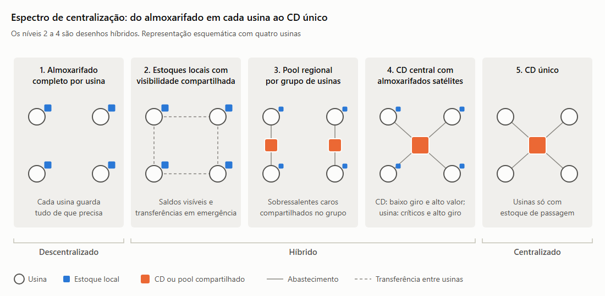
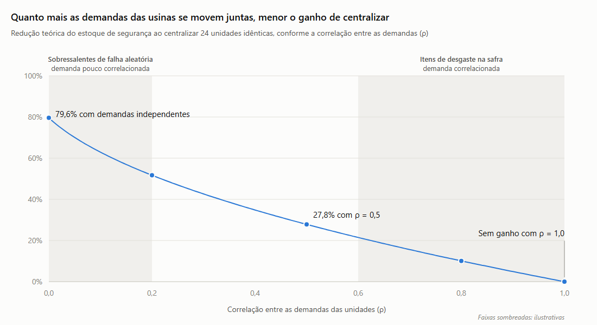
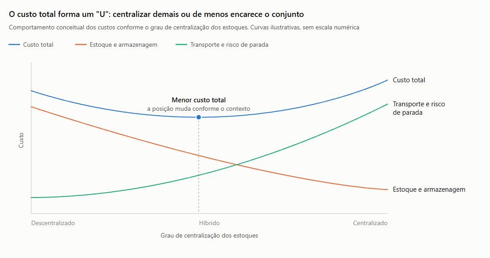
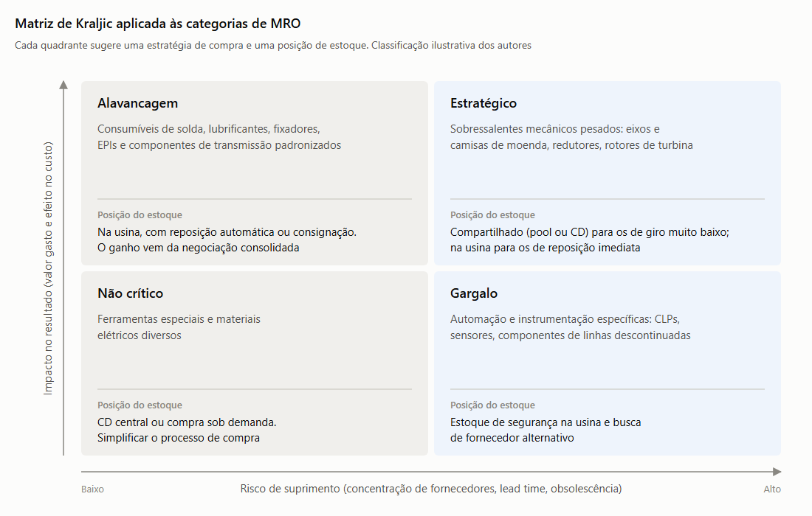

# Modelos de gestão e armazenagem

:::info Resumo executivo
1. **Centralizar reduz estoque, descentralizar reduz tempo de atendimento.** Com 24 unidades e demandas independentes, a teoria indica até cerca de 80% menos estoque de segurança no modelo centralizado. Quando as demandas das usinas se movem juntas, como na safra, esse ganho cai rapidamente.
2. **Em MRO, a decisão é tomada item a item.** O critério central é comparar o tempo que o estoque leva para chegar ao ativo com o tempo que o ativo pode ficar parado. Por isso, o modelo híbrido é a forma mais comum de organizar sobressalentes em redes com várias unidades.
3. **Na Raízen, a compra já é híbrida, e a forma como os estoques estão distribuídos não é pública.** A análise aplicada à empresa usa um cenário genérico e não constitui recomendação para o case real.
:::

Esta página compara os três modelos de armazenagem de materiais MRO e prepara os critérios usados na [matriz de decisão](./Matriz_Decisao_Multicriterio.md). As categorias de materiais e os fatores logísticos vêm da página [Mercado fornecedor e logística](./Mercado_Fornecedor_Logistica.md). Os números da empresa seguem os [números-base](./Retomada_Contexto.md#numeros-base) do projeto.

---

## Comparação dos modelos

Tabela 1 — Comparação entre os modelos centralizado, descentralizado e híbrido para estoques MRO

| Modelo | Funcionamento | Benefícios | Riscos | Limitações | Contextos favoráveis |
|---|---|---|---|---|---|
| **Centralizado** | Um centro de distribuição (CD) mantém o estoque de todas as unidades. A usina recebe o material por transferência e guarda, no máximo, um estoque de passagem. | Menor estoque de segurança total, porque a variação de demanda das unidades se compensa (Maister, 1976; Eppen, 1979). Compra e recebimento consolidados. Cadastro, inventário e controle em um único ponto. | Parada prolongada quando um item crítico precisa viajar do CD até a usina. Dependência de um único ponto: uma falha no CD ou na rota afeta todas as unidades. | Exige transporte confiável e frequente até cada unidade. Acrescenta uma etapa de transferência e o seu custo de frete. | Itens caros e de giro muito baixo. Unidades próximas entre si. Ativos com reserva instalada ou com tempo tolerável de parada maior que o tempo de transferência. |
| **Descentralizado** | Cada unidade mantém o seu próprio almoxarifado, com estoque para atender localmente às suas necessidades. | Atendimento imediato ao ativo. Autonomia da unidade e conhecimento local dos equipamentos. Sem dependência de transporte entre unidades. | Duplicação de estoques e capital imobilizado mais alto. Obsolescência de itens parados em várias unidades. Cadastros divergentes entre unidades, com compras de itens que já existem em outra usina. | Cada unidade dimensiona o estoque para a sua própria variação, sem compensação entre unidades. Menor poder de negociação se a compra também for local. | Ativos críticos sem reserva e com tempo tolerável de parada curto. Unidades isoladas ou distantes. Itens de alto giro e baixo valor. |
| **Híbrido** | Combina os dois modelos, segmentando os itens: os de reposição imediata ficam na unidade, e os de baixo giro e alto valor ficam em um ponto compartilhado (CD central ou regional). Pode incluir visibilidade de saldos e transferências entre unidades. | Concentra o ganho de escala nos itens em que ele é maior e mantém a proximidade nos itens em que o tempo é decisivo. Permite tratar de forma diferente materiais com riscos diferentes (Huiskonen, 2001). | Regras de segmentação mal definidas levam itens críticos para longe do ativo. Mais complexidade de gestão e risco de conflito entre a unidade e o CD. | Depende de classificação confiável (Curva ABC e criticidade) e de cadastro único entre unidades. Exige governança para revisar a segmentação periodicamente. | Redes com várias unidades parecidas, mix de itens com perfis diferentes e pressão simultânea por capital de giro e por disponibilidade. |

Fonte: Elaborado pelos autores com base em Maister (1976), Eppen (1979), Huiskonen (2001) e Cleverence (2026).

### Espectro de centralização

Os três modelos não são caixas fechadas: formam um espectro, e o híbrido reúne os desenhos intermediários. Separar esses desenhos ajuda a evitar uma comparação apenas entre os dois extremos.

Tabela 2 — Espectro de centralização de estoques MRO

| Nível | Desenho | Como funciona | Classificação |
|---|---|---|---|
| 1 | Almoxarifado completo por unidade | Cada usina mantém todo o estoque de que precisa, sem compartilhamento | Descentralizado |
| 2 | Estoques locais com visibilidade compartilhada | Estoques continuam nas usinas, mas com cadastro único e saldos visíveis entre unidades, o que permite transferências em emergências | Híbrido |
| 3 | *Pool* regional | Um almoxarifado de referência por grupo de usinas próximas guarda os sobressalentes caros, compartilhados pelo grupo | Híbrido |
| 4 | CD central com almoxarifados satélites (*hub-and-spoke*) | O CD guarda os itens de baixo giro e alto valor. Os satélites, nas usinas, guardam os itens de alto giro e os críticos de reposição imediata | Híbrido |
| 5 | CD único | Um único CD abastece todas as unidades, que mantêm apenas estoque de passagem | Centralizado |

Fonte: Elaborado pelos autores.

Figura 1 — Espectro de centralização dos estoques MRO

Fonte: Elaborado pelos autores. Representação esquemática.

---

## Dimensões para comparação

Tabela 3 — Desempenho relativo dos modelos nas sete dimensões de comparação

| Dimensão | Centralizado | Descentralizado | Híbrido |
|---|---|---|---|
| **Nível de serviço** | Alto para itens planejados. Menor para quebras, porque depende do transporte | Alto para itens estocados localmente, mas cai para itens que a unidade decide não estocar | Alto se a segmentação estiver correta, porque os itens críticos ficam perto do ativo |
| **Tempo de atendimento** | Maior: soma o tempo de transferência do CD até a usina | Menor: atendimento imediato no almoxarifado local | Imediato para itens locais e com transferência para itens compartilhados |
| **Capital imobilizado** | Menor, pelo efeito de compensação de demandas (ver a seção abaixo) | Maior: cada unidade carrega o próprio estoque de segurança | Intermediário: o ganho de escala concentra-se nos itens caros e de baixo giro |
| **Transporte** | Compra consolidada até o CD, mas acrescenta a transferência até cada usina, inclusive fretes urgentes | Entregas fracionadas do fornecedor a cada usina, sem transferências | Combina os dois fluxos, por isso exige planejamento de rotas |
| **Governança** | Controle e cadastro em um único ponto | Controle disperso, com risco de cadastros divergentes | Exige regras claras de segmentação e um cadastro único para funcionar |
| **Escala** | Máxima em compra, armazenagem e especialização da equipe | Mínima: cada unidade opera em pequena escala | Escala nos itens compartilhados, com operação local nos demais |
| **Risco de parada** | Maior para ativos críticos sem reserva, se o tempo de transferência superar o tempo tolerável de parada | Menor para itens estocados, mas aumenta quando a pressão por capital leva a cortes de estoque local | Menor quando o tempo de atendimento é usado como critério de segmentação |

Fonte: Elaborado pelos autores com base em Eppen (1979), Huiskonen (2001) e Cleverence (2026).

### Quanto estoque a centralização economiza: o efeito de compensação de demandas

A principal vantagem da centralização é estatística. Quando várias unidades compartilham um mesmo estoque, a demanda acima da média em uma tende a ser compensada pela demanda abaixo da média em outra. Por isso, o estoque de segurança necessário para o conjunto é menor do que a soma dos estoques de segurança de cada unidade. Esse efeito é conhecido como *risk pooling*, e sua forma mais citada é a "lei da raiz quadrada" de Maister (1976).

Eppen (1979) mostrou que o tamanho dessa economia depende da **correlação** entre as demandas: quanto mais as demandas das unidades se movem juntas, menor é a compensação e menor é a economia.

Cálculo do estoque de segurança nos dois modelos

Considere *n* unidades iguais, cada uma com desvio-padrão de demanda σ, prazo de reposição *L* e fator de segurança *z* (definido pelo nível de serviço desejado), e correlação ρ entre as demandas das unidades.

- **Descentralizado:** estoque de segurança total = *n* · *z* · σ · √*L*
- **Centralizado:** estoque de segurança = *z* · σ · √(*n* + *n*(*n* − 1)ρ) · √*L*
- **Razão entre os dois:** √(*n* + *n*(*n* − 1)ρ) ÷ *n*

Com ρ = 0, a razão é 1 ÷ √*n*, a "lei da raiz quadrada". Com ρ = 1, a razão é 1, e a centralização não reduz o estoque de segurança.

A Tabela 4 aplica o cálculo a uma rede com o mesmo número de unidades da Raízen em 31/03/2026 (24 usinas). Os demais valores são hipotéticos, e o cálculo mostra apenas o efeito relativo.

Tabela 4 — Redução teórica do estoque de segurança ao centralizar 24 unidades, conforme a correlação entre as demandas

| Correlação entre as demandas (ρ) | Estoque de segurança centralizado (% do descentralizado) | Redução teórica |
|---:|---:|---:|
| 0,0 | 20,4% | 79,6% |
| 0,2 | 48,3% | 51,7% |
| 0,5 | 72,2% | 27,8% |
| 0,8 | 89,9% | 10,1% |
| 1,0 | 100,0% | 0,0% |

Fonte: Elaborado pelos autores com base em Maister (1976) e Eppen (1979). Cenário hipotético com 24 unidades idênticas; cálculos dos autores.

Figura 2 — Redução teórica do estoque de segurança ao centralizar 24 unidades, conforme a correlação entre as demandas

Fonte: Elaborado pelos autores com base em Maister (1976) e Eppen (1979). Cálculo dos autores; as faixas sombreadas são ilustrativas.

**Leitura da Tabela 4 e da Figura 2:**

1. **Fato (método):** com demandas independentes, centralizar 24 unidades exige cerca de um quinto do estoque de segurança do modelo descentralizado.
2. **Inferência dos autores:** nas usinas sucroenergéticas, o grau de correlação varia conforme o tipo de item.
   - **Itens de desgaste**, como facas, martelos e revestimentos de moenda, tendem a ter demanda correlacionada. Todas as usinas seguem o mesmo calendário de safra, e o clima afeta todas ao mesmo tempo: a cana queimada e as impurezas minerais aceleram o desgaste em toda a rede (ver [Drivers, tendências e desafios](../002_Contexto_Setorial_Operacao_Suprimentos/Drivers_Tendencias_Desafios.md)).
   - **Sobressalentes de falhas aleatórias**, como um redutor ou um rotor de turbina, tendem a ter demanda pouco correlacionada, porque a quebra de um equipamento em uma usina não depende da quebra em outra.
   - Por isso, o ganho da centralização tende a ser maior nos sobressalentes de falha aleatória do que nos itens de desgaste.
3. **Limitações do cálculo:**
   - Vale apenas para o estoque de segurança, e não para o estoque de ciclo (Maister, 1976).
   - Supõe demanda com distribuição normal. Sobressalentes de giro muito baixo têm demanda intermitente, e o valor exato muda, embora a lógica de compartilhar se mantenha.
   - Não considera o tempo de transferência do CD até a usina, que é tratado na seção [Trade-offs](#trade-offs).

---

## Trade-offs

A escolha do modelo envolve objetivos que entram em conflito. Nenhum modelo é superior em todos eles.

Tabela 5 — Efeito do grau de centralização sobre os componentes do custo total

| Componente do custo | Quando a centralização aumenta | Por quê |
|---|---|---|
| Custo de manter estoque (capital, seguro, obsolescência) | Cai | Menos estoque de segurança e menos itens duplicados |
| Custo de armazenagem (estrutura e equipe) | Cai | Escala e especialização em menos locais |
| Frete de abastecimento (fornecedor → estoque) | Cai | Compras consolidadas em menos pontos de entrega |
| Frete de distribuição (estoque → usina) | Sobe | Nova etapa de transferência, incluindo fretes urgentes nas quebras |
| Custo de parada por falta de material | Sobe | O tempo de atendimento aumenta para os itens que deixam a usina |
| Custo de gestão e coordenação | Varia | Cai no controle de cadastro, mas sobe na coordenação entre CD e unidades |

Fonte: Elaborado pelos autores com base em Eppen (1979), IMAM (2026) e Cleverence (2026).

Somados, esses componentes formam uma curva de custo total em forma de "U". A partir de certo ponto, o aumento do frete e do custo de parada supera a economia de estoque, e centralizar mais passa a encarecer o conjunto. A posição desse ponto depende de cada contexto. Por isso, comparar os modelos só pelo frete leva a erros: o custo total inclui estoques de segurança, estrutura, perdas e tributos ([Cleverence](https://www.cleverence.com/articles/3pl-reviews-pt/centralized-vs-decentralized-warehousing-pros-costs-choose-4829/), 2026).

Figura 3 — Comportamento dos custos conforme o grau de centralização dos estoques

Fonte: Elaborado pelos autores com base em IMAM (2026) e Cleverence (2026). Curvas conceituais, sem escala numérica.

O [IMAM](https://blog.imam.com.br/centralizar-ou-descentralizar-a-distribuicao/) (2026) descreve a decisão como uma troca compensatória (*trade-off*) avaliada pelo custo total logístico. Em teoria, descentralizar aumenta os custos de armazenagem e de manutenção de estoques e reduz o custo de transporte. O próprio IMAM alerta, porém, que esse resultado é "só em teoria": a operação atual pode estar mal dimensionada, e posicionar estoque dos itens errados perto do cliente não melhora o serviço e ainda aumenta as transferências. Esse alerta reforça a necessidade de segmentar os itens antes de escolher o modelo.

Três conflitos resumem a decisão:

1. **Capital de giro × disponibilidade.** Centralizar libera capital, mas afasta o material do ativo.
2. **Escala × agilidade.** Concentrar a compra e a armazenagem reduz custos unitários, mas acrescenta uma etapa entre a necessidade e a entrega.
3. **Controle corporativo × autonomia local.** Um ponto único facilita o controle, mas tira da unidade a decisão sobre o que manter à mão.

Em MRO, o custo de parada pesa mais do que em outros tipos de estoque. Numa usina em safra, a falta de uma peça crítica pode interromper a moagem, e a cana colhida perde valor rapidamente (ver [Empresa, manutenção e Suprimentos](../002_Contexto_Setorial_Operacao_Suprimentos/Empresa_Operacao_Suprimentos.md)). Daí decorre a regra que orienta a segmentação e também os critérios da [matriz de decisão](./Matriz_Decisao_Multicriterio.md):

:::tip Regra de decisão para itens críticos
Um item crítico só pode ficar em estoque compartilhado se o **tempo de atendimento** a partir desse estoque for **menor ou igual ao tempo tolerável de parada** do ativo que ele protege.
:::

Para sobressalentes pesados, a própria troca do componente costuma levar mais tempo que o transporte entre unidades de uma mesma região. Nesses casos, o transporte deixa de ser o fator decisivo, e o compartilhamento do estoque se torna viável (*inferência dos autores*).

---

## Aplicação ao contexto pesquisado

:::warning Aplicação genérica
Esta seção relaciona os modelos às características públicas da Raízen. Não descreve a organização interna real dos estoques da empresa nem apresenta recomendação para a Atvos ou para o case real.
:::

### Segmentação dos itens: onde cada material tende a ficar

Huiskonen (2001) argumenta que os sobressalentes de manutenção diferem dos demais materiais e devem ser geridos por segmentos. Os principais aspectos são a criticidade, a especificidade, o padrão de demanda e o valor. A matriz de Kraljic (1983) complementa essa visão do lado da compra. Ela classifica os itens pelo impacto no resultado e pelo risco de suprimento, gerando quatro quadrantes:

- **Estratégico:** alto impacto e alto risco.
- **Gargalo:** baixo impacto e alto risco.
- **Alavancagem:** alto impacto e baixo risco.
- **Não crítico:** baixo impacto e baixo risco.

A Figura 4 posiciona as categorias de MRO da página [Mercado fornecedor e logística](./Mercado_Fornecedor_Logistica.md) nos quadrantes, e a Tabela 6 combina os dois enfoques numa regra de alocação.

Figura 4 — Matriz de Kraljic aplicada às categorias de MRO

Fonte: Elaborado pelos autores com base em Kraljic (1983) e nas categorias da página Mercado fornecedor e logística. Classificação ilustrativa.

Tabela 6 — Regra de alocação de estoques por segmento de item (cenário genérico)

| Segmento | Quadrante de Kraljic (ilustrativo) | Exemplos | Posição sugerida no cenário genérico | Justificativa |
|---|---|---|---|---|
| Crítico, de reposição imediata | Estratégico ou gargalo | Rolamentos e vedações de bombas de caldo, componentes de reposição rápida de moendas e caldeiras | Na usina (local) | O tempo tolerável de parada é menor que o tempo de transferência |
| Crítico, de alto valor e giro muito baixo (sobressalente de "seguro") | Estratégico | Eixos e camisas de moenda, redutores principais, rotores de turbina | Compartilhado (*pool* regional ou CD central) | Alto valor parado em cada usina, demanda pouco correlacionada e troca demorada, o que torna o transporte menos decisivo |
| Não crítico, de alto giro | Alavancagem | Consumíveis de solda, lubrificantes, fixadores, EPIs | Na usina, com reposição automática ou consignação no fornecedor | Consumo regular e mercado pulverizado: o ganho vem da negociação consolidada, não de centralizar o estoque físico |
| Não crítico, de baixo giro | Não crítico | Ferramentas especiais, materiais elétricos diversos | CD central ou compra sob demanda | Baixo risco operacional e pouca razão para manter o item em cada usina |
| Sazonal (paradas de entressafra) | Varia | Kits de componentes para a manutenção programada | Compra programada com entrega direta na usina | A demanda é previsível e se concentra numa janela conhecida |

Fonte: Elaborado pelos autores com base em Kraljic (1983), Huiskonen (2001) e na Tabela 1 da página Mercado fornecedor e logística. Classificação ilustrativa, não baseada em dados internos.

A tabela não substitui a classificação por Curva ABC e criticidade da página [Materiais e estoques MRO](./Materiais_MRO.md). Ela indica como essa classificação se traduz em localização do estoque.

### Características públicas da Raízen que influenciam a escolha

Tabela 7 — Características públicas da Raízen e sua relação com os modelos de estoque

| Característica | Evidência pública | Relação com os modelos (*inferência dos autores*) |
|---|---|---|
| Rede de unidades dispersa | 24 usinas em 31/03/2026, com operação agroindustrial em SP, GO, MS e MG ([Raízen](https://www.raizen.com.br/items-files/item-1500-raizen-ri25-26.pdf), 2026) | Distâncias entre estados tornam um CD único menos provável para itens críticos. Grupos de usinas próximas favorecem *pools* regionais |
| Unidades com desenho produtivo semelhante | Todas produzem açúcar, etanol e bioenergia a partir da cana, com extração, caldeiras, destilaria e fábrica de açúcar ([Raízen](https://www.raizen.com.br/items-files/item-1500-raizen-ri25-26.pdf), 2026) | Equipamentos parecidos aumentam a chance de um mesmo sobressalente servir a várias usinas, condição para compartilhar estoques |
| Compra já organizada de forma híbrida | Central de Compras corporativa, combinada com compras de baixo valor, delegadas, imediatas e emergenciais feitas pelas unidades ([Raízen](https://www.raizen.com.br/items-files/item-1495-plt-02-politica-sustentavel-de-suprimentos.pdf), 2025c) | A negociação é centralizada e a execução é local. A centralização da compra não implica a centralização do estoque físico |
| Demanda sazonal | 88% do investimento em manutenção de entressafra de 2025/26 ocorreu entre outubro e março ([Raízen](https://d169uzu5o4xu1k.cloudfront.net/e24e1732-fe1c-4eaf-9a28-ed09ccc472b1/2026/810dc9a4-f5df-4e56-99a7-737e2a01a829.pdf), 2026a) | O pico previsível favorece compras programadas e entregas diretas. Na safra, a demanda é emergencial e exige proximidade dos itens críticos |
| Pressão sobre o capital de giro | Estoque de almoxarifado consolidado caiu de R$ 1.122,9 milhões (31/03/2024) para R$ 853,2 milhões (31/03/2026), no período da recuperação extrajudicial ([Raízen](https://investidor10.com.br/acoes/link_comunicado/RAIZ4/45023/), 2026c) | A redução de estoque torna o compartilhamento mais atraente, mas o saldo é consolidado e mostra tendência, não o risco de falta nas usinas |

Fonte: Elaborado pelos autores com base em Raízen (2025c; 2026; 2026a; 2026c).

### Redução saudável de estoque × aumento do risco de parada

As tabelas desta página ajudam a separar os dois casos, ainda que sem dados internos (*inferência dos autores*):

- **Redução saudável:** elimina duplicações por meio do compartilhamento dos sobressalentes de "seguro" (Tabela 6) e de consignação ou reposição automática de consumíveis. O estoque cai sem afastar os itens críticos de reposição imediata.
- **Redução arriscada:** corta justamente os itens críticos que ficam na usina, ou centraliza itens cujo tempo de atendimento supera o tempo tolerável de parada.
- **Como distinguir na prática:** pelo nível de serviço dos itens críticos e pelo volume de compras emergenciais. A Raízen não divulga esses indicadores.

:::note Limitações
* Na pesquisa realizada, não foram encontradas informações públicas sobre a organização física dos estoques MRO da Raízen. Não há evidência de um CD central de materiais nem da estrutura dos almoxarifados por usina. Os resultados públicos sobre "centros de distribuição" referem-se à logística de combustíveis.
* Os municípios exatos das usinas e as distâncias entre elas não foram levantados. As inferências sobre *pools* regionais são qualitativas.
* O cálculo da Tabela 4 usa unidades idênticas e demanda com distribuição normal. Serve para mostrar o efeito da correlação, não para dimensionar estoques reais.
* A classificação de Kraljic e a segmentação da Tabela 6 são ilustrativas e foram construídas pelos autores a partir das categorias genéricas de MRO.
* A Cleverence (2026) é um blog de empresa de software, voltado sobretudo à distribuição de produtos acabados. Foi usada apenas para conceitos gerais de custo total.
:::

---

## Fontes

- CLEVERENCE. Armazenagem Centralizada vs Descentralizada: Vantagens, Custos e Como Escolher. Autor: Ashley Taylor. 2026. Disponível em: https://www.cleverence.com/articles/3pl-reviews-pt/centralized-vs-decentralized-warehousing-pros-costs-choose-4829/. Acesso em: 28/10/2026.
- EPPEN, Gary D. Note — Effects of centralization on expected costs in a multi-location newsboy problem. *Management Science*, v. 25, n. 5, p. 498-501, 1979. DOI: 10.1287/mnsc.25.5.498. Disponível em: https://doi.org/10.1287/mnsc.25.5.498. Acesso em: 28/10/2026.
- HUISKONEN, Janne. Maintenance spare parts logistics: special characteristics and strategic choices. *International Journal of Production Economics*, v. 71, n. 1-3, p. 125-133, 2001. DOI: 10.1016/S0925-5273(00)00112-2. Disponível em: https://ideas.repec.org/a/eee/proeco/v71y2001i1-3p125-133.html. Acesso em: 28/10/2026.
- IMAM. Centralizar ou descentralizar a distribuição: como decidir. Blog IMAM, 13 out. 2026. Republicação do acervo técnico da revista intraLOGÍSTICA. Disponível em: https://blog.imam.com.br/centralizar-ou-descentralizar-a-distribuicao/. Acesso em: 29/10/2026.
- KRALJIC, Peter. Purchasing must become supply management. *Harvard Business Review*, v. 61, n. 5, p. 109-117, set. 1983. Disponível em: https://hbr.org/1983/09/purchasing-must-become-supply-management. Acesso em: 28/10/2026.
- MAISTER, David H. Centralisation of inventories and the "square root law". *International Journal of Physical Distribution*, v. 6, n. 3, p. 124-134, 1976. DOI: 10.1108/eb014366. Disponível em: https://www.emerald.com/insight/content/doi/10.1108/eb014366/full/html. Acesso em: 28/10/2026.
- RAÍZEN. PLT.02 — Política de Suprimentos (versão 15). 2025c. Disponível em: https://www.raizen.com.br/items-files/item-1495-plt-02-politica-sustentavel-de-suprimentos.pdf. Acesso em: 06/10/2026.
- RAÍZEN. Relatório Integrado 2025'26. 2026. Disponível em: https://www.raizen.com.br/items-files/item-1500-raizen-ri25-26.pdf. Acesso em: 28/10/2026.
- RAÍZEN. Relatório de Resultados: 4º Trimestre e Ano-Safra 2025'26. 2026a. Disponível em: https://d169uzu5o4xu1k.cloudfront.net/e24e1732-fe1c-4eaf-9a28-ed09ccc472b1/2026/810dc9a4-f5df-4e56-99a7-737e2a01a829.pdf. Acesso em: 06/10/2026.
- RAÍZEN. Individual and consolidated financial statements as of March 31, 2026 and independent auditor's report. 2026c. Disponível em: https://investidor10.com.br/acoes/link_comunicado/RAIZ4/45023/. Acesso em: 06/10/2026.
